# 🚀 Awesome Infrastructure Migration Management

**The definitive curated directory of enterprise SaaS platforms, hyperscaler cloud hubs, and open-source migration tools for lift-and-shift server replication, zero-downtime database cutovers, object storage synchronization, and multi-cloud infrastructure mobility.**

*Tracked and updated actively for cloud architects, DevOps engineers, systems administrators, and site reliability engineers (SREs).*

[🌐 Sector Overview](#-sector-overview--market-dynamics) • [💼 Enterprise SaaS](#-saashosted-platforms) • [🛠️ Open-Source Engines](#-open-source-github-projects) • [⭐ Star History](#-star-history) • [🤝 Support](#-support) • [📝 Contributing](#-how-to-contribute)

---

## 📑 Table of Contents

- [🌐 Sector Overview & Market Dynamics](#-sector-overview--market-dynamics)
- [💼 SaaS/Hosted Platforms](#-saashosted-platforms)
- [🛠️ Open-Source GitHub Projects](#-open-source-github-projects)
  - [📦 Object Storage & Cloud Sync](#-object-storage--cloud-sync)
  - [🔄 Change Data Capture & Database Migration](#-change-data-capture--database-migration)
  - [🐳 Container & Kubernetes Mobility](#-container--kubernetes-mobility)
  - [🖥️ Virtual Machine & Cloud Onboarding](#-virtual-machine--cloud-onboarding)
- [🧰 Specialized Non-GitHub Open-Source Tools](#-specialized-non-github-open-source-tools)
- [⭐ Star History](#-star-history)
- [💖 Support](#-support)
- [🤝 How to Contribute](#-how-to-contribute)
- [⚖️ Disclaimer](#-disclaimer)

---

## 🌐 Sector Overview & Market Dynamics

The global cloud infrastructure migration and modernization market represents one of the fastest-accelerating segments in enterprise enterprise IT. Market intelligence estimates place the total market size between **$268B and $323B in 2025**, projected to surge past **$330B to $406B by 2026** at a 23%–27% CAGR. This rapid growth is propelled by enterprise workload re-platforming for AI/ML pipelines, Kubernetes modernization, and hybrid multi-cloud resilience strategies.

From an industry structure perspective, the ecosystem exhibits a dual dynamic:
- **Concentrated Hyperscaler Tier (Winner-Take-Most):** The foundational discovery, assessment, and direct target ingestion layer is heavily anchored by the dominant cloud hyperscalers—**Microsoft Azure Migrate**, **AWS Application Migration Service**, and **Google Cloud Migration Center**. These platforms offer integrated financial incentives, native hypervisor agents, and zero-cost ingress replication tools to capture recurring compute revenue.
- **Moderately Fragmented Specialist Tier:** Outside hyperscaler target boundaries, the market remains dynamic and fragmented across third-party hypervisor replication suites (**Zerto**, **RiverMeadow**, **Carbonite Migrate**), cross-platform block/object sync engines (**NetApp**, **rclone**, **Chorus**), and real-time database migration orchestrators (**Debezium**, **pgloader**).

---

## 💼 SaaS/Hosted Platforms

Enterprise cloud migration suites offering managed control planes, continuous replication agents, right-sizing cost analytics, and automated server cutover orchestration.

| 🏢 Platform | 💰 Company Valuation / Revenue | 🏷️ Starting Price | 🎁 Free Tier / Trial Limit | 📋 Key Migration Capabilities |
|---|---|---|---|---|
| **[Azure Migrate](https://azure.microsoft.com/en-us/products/azure-migrate)** | Microsoft ($3.1T Market Cap / $245B+ Annual Rev) | Free tool; target Azure compute/storage billing applies upon cutover | Free forever (discovery, assessment & migration tooling included at no cost with Azure account) | Microsoft's unified migration hub combining discovery, right-sizing assessment, and execution for VMware, Hyper-V, and physical servers. |
| **[Google Migrate (Migration Center)](https://cloud.google.com/migration-center)** | Alphabet ($2.2T Market Cap / $350B+ Annual Rev) | Free discovery & assessment; standard target GCP resource rates apply | Free forever for discovery & TCO planning; $300 new account credit for 90 days for provisioned test workloads | Google Cloud discovery and planning hub with AI-powered Quick Assessments and multi-year TCO projections. |
| **[AWS Application Migration Service (MGN)](https://aws.amazon.com/application-migration-service/)** | Amazon ($2.0T Market Cap / $620B+ Annual Rev) | $0.04/hour per server after free period (target EC2/EBS infrastructure costs apply) | 2,160 hours (90 days) free replication per registered source server | Hyperscaler-native block-level replication for lifting physical, virtual, or cloud servers into AWS with minimal downtime. |
| **[IBM Turbonomic](https://www.ibm.com/products/turbonomic)** | IBM ($200B Market Cap / $62B+ Annual Rev) | Custom quoted (~$38,000–$50,000/yr list for 200 managed workloads on AWS/Azure Marketplace) | 30-day free trial with full resource and infrastructure optimization access | Performance and cost optimization platform for hybrid and multi-cloud estates; continuously balances workload resource allocation. |
| **[Zerto](https://www.zerto.com/)** | HPE ($25B Market Cap / $30B+ Annual Rev) | Custom quoted (~$1,400–$2,200/VM/yr list for Enterprise Cloud Edition via HPE GreenLake) | 30-day enterprise Proof-of-Concept (PoC) evaluation upon sales approval | Continuous block-level replication platform optimized for lift-and-shift with near-zero downtime and RPOs in seconds. |
| **[NetApp Cloud Sync](https://cloud.netapp.com/cloud-sync-service)** | NetApp ($26B Market Cap / $6.3B Annual Rev) | $0.15/relationship/hour on AWS/Azure Marketplace pay-as-you-go | 14-day free trial with unlimited sync relationships | High-speed file and object synchronization service across NFS, SMB, AWS S3, and Azure Blob storage targets. |
| **[Carbonite Migrate](https://www.carbonite.com/)** | OpenText ($8B Market Cap / $5.8B Annual Rev) | Custom quote (typically project-based 60-day node-locked licenses per source server) | 30-day sales-assisted Proof of Concept (PoC) license for enterprise environments | Real-time byte-level replication migration tool for physical, virtual, and cloud workloads with push-button failover. |
| **[PlateSpin Migrate](https://www.microfocus.com/)** | OpenText ($8B Market Cap / $5.8B Annual Rev) | Custom quote (per-workload 1-year subscription licenses via enterprise software distributors) | 30-day evaluation trial (restricted to up to 5 replications across up to 3 workloads) | Server workload mobility platform across physical machines, hypervisors, and public clouds with block-level delta sync. |
| **[RiverMeadow](https://www.rivermeadow.com/)** | RiverMeadow Software (Privately held, ~$15M–$25M Est. Valuation) | Custom quote (fixed-price per-workload migration model; $0 tooling via AWS ISV MAP programs) | Custom sales demo and project-scoped 14-day Proof of Concept (PoC) for qualified workloads | Workload mobility and automated cloud onboarding platform built for rapid mass enterprise server migrations. |

---

## 🛠️ Open-Source GitHub Projects

Battle-tested open-source migration utilities, data movers, change data capture (CDC) pipelines, and container mobility frameworks. Ranked in **descending order by GitHub stargazers count**.

### 📦 Object Storage & Cloud Sync

- **[rclone](https://github.com/rclone/rclone)**   
  *The Swiss Army knife of cloud storage data migration.* High-performance command-line utility for synchronizing files and directories to and from 70+ storage providers including AWS S3, Google Cloud Storage, Azure Blob, Ceph, SFTP, and WebDAV. Features multi-threaded transfers, partial sync verification via MD5/SHA1, bandwidth shaping, and cryptographic data mounting.

- **[restic](https://github.com/restic/restic)**   
  *Fast, secure, and deduplicated filesystem replication program.* Ideal for lifting complete server filesystem states across disparate cloud storage destinations. Implements end-to-end authenticated encryption, verifiable content-addressable chunk deduplication, and zero-dependency standalone Go binary binaries.

- **[Chorus](https://github.com/clyso/chorus)**   
  *Distributed S3 and OpenStack Swift storage migration platform.* Purpose-built for zero-downtime object storage migration between cloud providers (AWS, GCP, Ceph, MinIO). Provides real-time event capture and change propagation, bi-directional proxy routing, background diff checking, and progressive provider cutover.

- **[sclone](https://github.com/carboneio/sclone)**   
  *High-throughput object storage clone utility for S3 and Swift.* Designed with parallelized file-list caching and worker pools for ultra-fast unidirectional and bidirectional bucket synchronization. Benchmarks significantly faster than standard single-threaded sync scripts for large file trees.

---

### 🔄 Change Data Capture & Database Migration

- **[Debezium](https://github.com/debezium/debezium)**   
  *Distributed change data capture (CDC) platform for zero-downtime database migration.* Tailored for live production database migrations with zero maintenance window. Tails transaction commit logs across PostgreSQL, MySQL, MariaDB, Oracle, MongoDB, and Microsoft SQL Server to stream low-latency row changes into Apache Kafka, ensuring target database parity prior to DNS cutover.

- **[pgloader](https://github.com/dimitri/pgloader)**   
  *Automated database migration suite for PostgreSQL.* Performs continuous, end-to-end migrations from MySQL, SQLite, MS SQL Server, and flat file feeds into PostgreSQL. Features automated schema discovery, datatype mapping, index rebuilding, and multi-threaded streamed `COPY` pipelines with in-flight data casting.

- **[Bani](https://github.com/mugumedavid/bani)**   
  *Apache Arrow-powered multi-database migration engine.* Provides high-throughput batch conversion across PostgreSQL, MySQL, MSSQL, Oracle, and SQLite, featuring a declarative Bani Definition Language (BDL) and an MCP server for AI-assisted migration flows.

---

### 🐳 Container & Kubernetes Mobility

- **[Skopeo](https://github.com/containers/skopeo)**   
  *Container registry migration and image sync engine.* Copies container images and multi-architecture manifests directly between remote OCI/Docker image registries (AWS ECR, Google Artifact Registry, Azure ACR, Harbor, Quay) without requiring root privileges or a running Docker daemon.

- **[Velero](https://github.com/vmware-tanzu/velero)**   
  *Cloud-native Kubernetes cluster backup and cross-cloud migration tool.* Enables seamless migration of entire Kubernetes applications, manifest states, and persistent volume snapshots across clusters, Kubernetes versions, and cloud infrastructures (AWS EKS, GCP GKE, Azure AKS, on-premises OpenShift).

---

### 🖥️ Virtual Machine & Cloud Onboarding

- **[Forklift](https://github.com/kubev2v/forklift)**   
  *Kubernetes & OpenShift virtualization migration operator.* Provides cold and warm VM migration from VMware vSphere, Red Hat Virtualization (RHV), and OpenStack into KubeVirt/OpenShift Virtualization with automated storage and network mapping.

- **[Coriolis](https://github.com/cloudbase/coriolis)**   
  *Cloud Migration-as-a-Service engine for enterprise hypervisors and clouds.* Automates lift-and-shift of Linux and Windows virtual machines between VMware vSphere, OpenStack, AWS, Azure, and Oracle Cloud with automated OS reconfiguration and driver injection.

- **[AWS Cloud Migration Factory](https://github.com/aws-solutions/cloud-migration-factory-on-aws)**   
  *Open-source enterprise migration orchestration framework by AWS Solutions.* Coordinates large-scale wave-based server migrations, automating server discovery ingestion, replication initiation via AWS MGN, and automated cutover verification.

- **[Azure App Service Migration Assistant](https://github.com/Azure/App-Service-Migration-Assistant)**   
  *Microsoft-supported web application migration tool.* Scans on-premises and hosted IIS / Apache web servers, evaluates cloud readiness, and automatically migrates web applications and configs into Azure App Service.

---

## 🧰 Specialized Non-GitHub Open-Source Tools

- **[PostgreSQL Migrator](https://gitlab.com/dalibo/pg_migrate)** (GitLab)  
  Pure Go database migration binary from Dalibo. Migrates Oracle and MySQL/MariaDB to PostgreSQL with offline catalog inspection, schema conversion, complexity scoring, and companion `transqlate` SQL transpilation.

- **[vps-backup-sync](https://gitea.com/cash602-cmd/vps-backup-sync)** (Gitea)  
  Zero-dependency shell-based server migration utility using rsync over SSH (`--partial --inplace`) with automated database dumping and SHA256 integrity verification.

---

## ⭐ Star History

---

## 💖 Support

Thank you for visiting and using **Awesome Infrastructure Migration Management**! Building and keeping this migration guide verified and up-to-date requires constant monitoring of new cloud tools, pricing shifts, and open-source updates.

If this repository has saved you or your team time during an infrastructure migration, please consider showing your support:

- ⭐ **Star this repository** to help others discover it on GitHub.
- 🍴 **Fork and share** it with fellow infrastructure engineers, DevOps specialists, and cloud architects.
- ☕ **Buy me a coffee / Sponsor**: If you'd like to support ongoing development, consider sponsoring via the [GitHub Sponsor Dashboard](https://github.com/sponsors/ishandutta2007).

---

## 🤝 How to Contribute

Contributions are warmly welcomed! Help expand this ecosystem by adding new SaaS migration platforms or active open-source tools:

1. 🍴 Fork the repository.
2. 🌿 Create a descriptive feature branch (`git checkout -b add-migration-tool`).
3. 📝 Update `README.md` following the existing tabular format for SaaS or star-sorted list for open-source repositories.
4. 🚀 Push changes and submit a pull request with an overview of why the tool is valuable.

---

## ⚖️ Disclaimer

- This is a **community-curated** reference list — not exhaustive and not a commercial endorsement.
- Infrastructure migration platforms handling production workloads must strictly adhere to enterprise security policies, compliance mandates, and data governance standards.
- Always verify active software license terms and execute thorough non-destructive migration dry-runs before scheduling production cutover windows.

---

**Made with ❤️ for infrastructure engineers, cloud architects, and DevOps teams moving workloads across the globe.**

